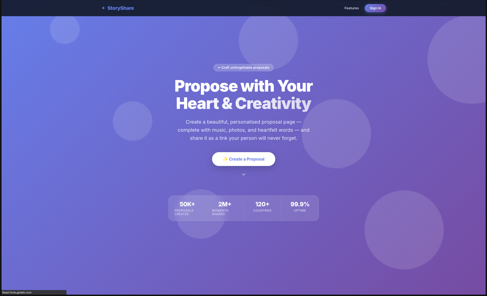
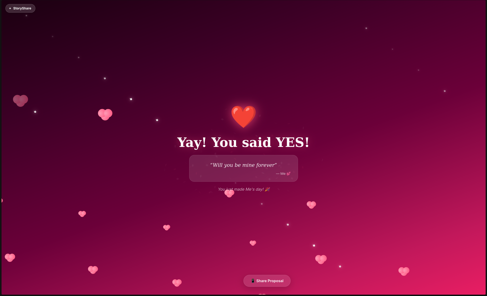

# StoryShare




## Live Demo
Check out the live platform here: **[https://story-share.app/](https://story-share.app/)**

## About StoryShare
StoryShare is a high-fidelity, interactive, and viral-ready digital greeting experience platform. It enables users to create, customize, and share magical moments—from beautifully animated birthday templates to highly immersive, interactive romantic proposals.

Built with a focus on modern, mobile-responsive design, StoryShare provides a premium viewer experience including:
- **Interactive Proposal Creator & Viewer**: Features thematic particle engines and global audio context for a seamless soundtrack integration.
- **Premium Birthday Templates**: A 3-stage viewer experience (Intro, Magical Gift Opening, Card Reveal) enriched with Framer Motion animations.
- **Seamless Payments**: Fully integrated with Razorpay for unlocking premium templates.
- **Modern Tech Stack**: 
  - **Frontend**: Next.js, Apollo Client, Framer Motion, Next-Auth.
  - **Backend**: Node.js, Express, Apollo Server (GraphQL), Mongoose, Zod.
  - **Monorepo**: Managed with `pnpm`.

## How to Setup

### Prerequisites
- [Node.js](https://nodejs.org/) (>= 22.0.0)
- [pnpm](https://pnpm.io/) package manager (v10.33.0 or later)
- MongoDB instance (Atlas or local)
- Razorpay account (for payment integrations)

### Installation

1. **Clone the repository:**
   ```bash
   git clone <your-repository-url>
   cd dynamic-site-monorepo
   ```

2. **Install dependencies:**
   From the root of the project, run:
   ```bash
   pnpm install
   ```

### Environment Variables
You will need to set up environment variables for both the `web` and `api` applications.
Create a `.env` file in `apps/api/` and `apps/web/` respectively, using the required configuration for MongoDB, Razorpay, and Next-Auth.

### Running the Application Locally

The project uses pnpm workspaces and provides root-level scripts to easily start the development servers.

1. **Start the API (Backend):**
   ```bash
   pnpm run dev:api
   ```
   This runs the Express and Apollo GraphQL server.

2. **Start the Web (Frontend):**
   In a separate terminal, run:
   ```bash
   pnpm run dev:web
   ```
   This runs the Next.js development server.

Visit `http://localhost:3000` in your browser to view the application.

## License
MIT
